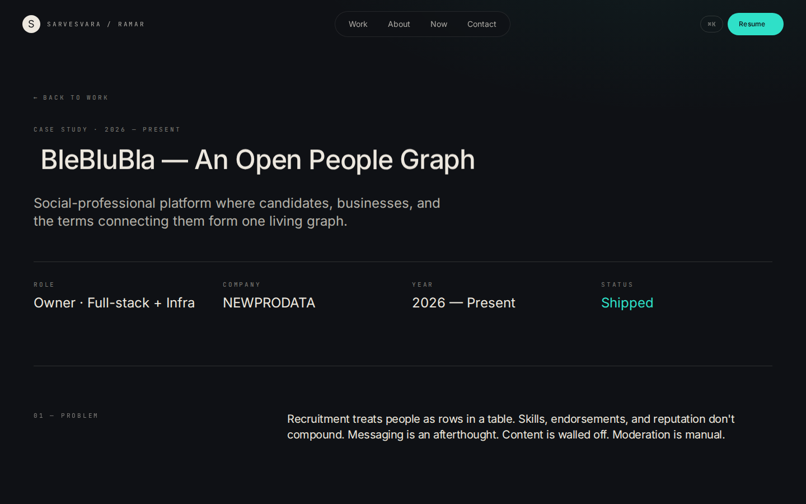
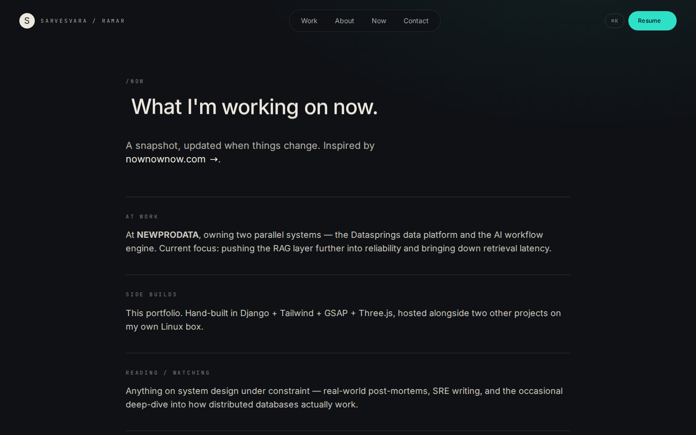

# Sarvesvara Ramar — Portfolio

**Live: [sarvesvara.datasprings.in](https://sarvesvara.datasprings.in)**

My personal portfolio: a hand-built Django site with case-study project pages,
an **AI assistant that answers questions about my work** (Google Gemini,
grounded on my own profile, projects and resume), a real production-incident
walkthrough, and a `/now` page that pulls my live GitHub activity. It is
self-hosted on my own Linux server behind nginx and Gunicorn.

<p align="center">
  
  &nbsp;
  
</p>

## Features

- **Bento-grid home page.** Profile, what I do, what I'm shipping now, role,
  experience and a live local clock, built with Tailwind, GSAP animations and a
  Three.js background.
- **"Ask about me" AI chat.** Visitors ask questions in plain English and
  Gemini (`gemini-2.5-flash`) answers using only my profile, project case
  studies and resume text, with strict no-invention rules. Questions are
  limited to 500 characters and rate-limited per visitor.
- **Project case studies.** Each project has its own page with role, company,
  year and status, plus Problem → Approach → Outcome sections and metrics, all
  editable from the Django admin.
- **Incident theater.** A scroll-driven, six-step walkthrough of a real
  production incident I debugged: how a `?` became `%3F` and silently emptied
  half a mobile app.
- **`/now` page.** What I'm working on, plus recent public GitHub activity
  (cached GitHub API).
- **Resume → projects with Gemini.** Uploading a PDF or DOCX resume in the admin
  extracts its text. That text feeds the AI chat and can draft project entries.
- **Contact form via SendGrid.** Validated, HTML-escaped and rate-limited, and
  sent in the background so the page responds instantly.
- **Extras:** ⌘K command palette, installable PWA with a service worker,
  sitemap.xml and robots.txt, optional Umami analytics, and a hidden easter egg.

<details>
<summary>More screenshots</summary>

**Project case study**


**/now**


</details>

## Tech stack

| Area | Tools |
|---|---|
| Backend | Python, Django 5.2 LTS, SQLite |
| AI | Google Gemini (`google-genai`), PyPDF2 / pdfminer, python-docx |
| Frontend | Django templates, Tailwind CSS, GSAP, Three.js, vanilla JS modules bundled with esbuild |
| Email | SendGrid |
| Serving | nginx (TLS) → Gunicorn over a Unix socket → Django; WhiteNoise for static files |
| Ops | systemd service, Let's Encrypt |

## Project structure

```
portfolio_site/          settings, root URLs (admin, sitemap, robots)
site_portfolio/
  models.py              Profile, Project (case-study fields), Resume
  views.py               pages, contact, AI endpoint, resume download, service worker
  ai_chat.py             Gemini prompt building and grounding
  incidents.py           data for the incident walkthrough
  admin.py               admin, resume text extraction
  static/site_portfolio/ images, video, vendor libraries, built dist/
frontend/src/            Tailwind CSS + JS modules (AI chat, command palette,
                         incident timeline, text/reveal animations)
templates/site_portfolio/
deployment/              nginx vhost and systemd unit used in production
```

## Run it locally

```bash
git clone https://github.com/sarves29/Sarvesvara-Portfolio.git
cd Sarvesvara-Portfolio

python -m venv venv && source venv/bin/activate
pip install -r requirements.txt
npm ci && npm run build          # Tailwind + JS bundle -> static/site_portfolio/dist/

cp .env.example .env             # set DJANGO_DEBUG=True for local work
python manage.py migrate
python manage.py loaddata initial_projects.json
python manage.py createsuperuser
python manage.py runserver
```

Use `npm run dev` to rebuild CSS and JS as you edit. The AI chat needs
`GOOGLE_API_KEY` and the contact form needs `SENDGRID_API_KEY`; the rest of the
site works without them. All settings are listed in [`.env.example`](.env.example).

## Deployment

Production runs as a systemd service (`deployment/systemd/`). Gunicorn listens
on a Unix socket behind nginx (`deployment/nginx/`). To deploy an update:

```bash
git pull
venv/bin/pip install -r requirements.txt
npm ci && npm run build
venv/bin/python manage.py migrate
venv/bin/python manage.py collectstatic --noinput
kill -HUP $(systemctl show -p MainPID --value sarvesvara-portfolio)   # graceful reload
```

## Security

- All secrets come from `.env` (mode 600), never from the code. With
  `DJANGO_DEBUG` off, the app refuses to start without a secret key.
- In production: HTTPS redirect, HSTS, secure cookies, `nosniff`, a strict
  referrer policy and clickjacking protection.
- The AI and contact endpoints are rate-limited per client IP. The IP comes
  from nginx's `X-Real-IP` header, which a visitor cannot fake.
- Contact-form input is validated and HTML-escaped before it reaches an email.
- No default admin password. Admin passwords must pass Django's password validators.

## Contact

**Sarvesvara Ramar** — Backend / Product Engineer, Chennai

- Website: [sarvesvara.datasprings.in](https://sarvesvara.datasprings.in)
- LinkedIn: [linkedin.com/in/sarvesvara-r-b2b310249](https://www.linkedin.com/in/sarvesvara-r-b2b310249/)
- Email: [sarvesvarasar@gmail.com](mailto:sarvesvarasar@gmail.com)
- Also see [DevSpace](https://github.com/sarves29/DevSpace_public), a secure, phone-first developer portal for Claude Code
