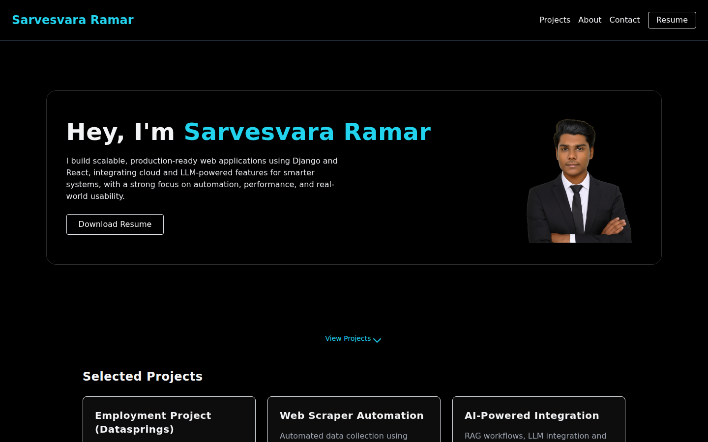
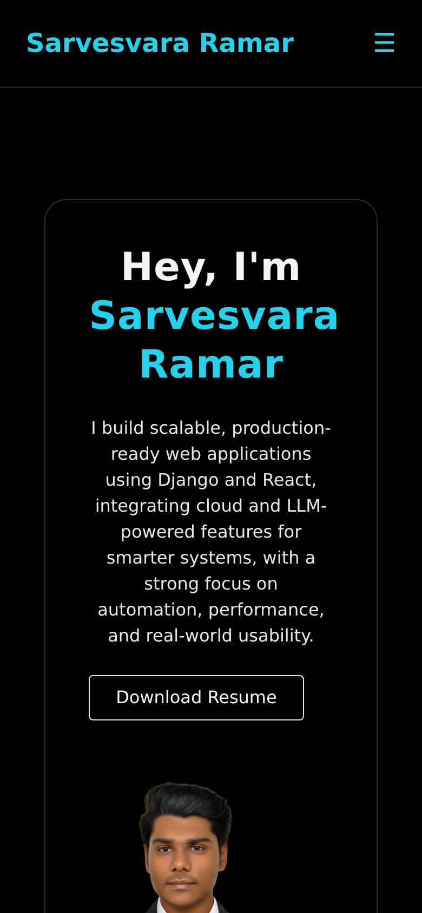

# Sarvesvara Ramar — Portfolio

A personal portfolio website built with **Django**. It shows my projects, lets
visitors download my resume and contact me, and includes an **AI-powered admin**:
upload a resume and Google Gemini extracts the projects from it and publishes
them to the site automatically.

<p align="center">
  
  &nbsp;
  
</p>

## Features

- **Projects showcase.** Projects are database-driven, each with a summary,
  tech tags, GitHub/demo links, an image and a detail page (`/projects/<slug>/`).
  Featured flag and display order can be edited from the admin.
- **Resume → projects with Gemini.** Uploading a PDF or DOCX resume in the
  Django admin extracts its text (PyPDF2 / python-docx) and asks
  `gemini-2.5-flash` to return the technical projects as structured JSON. New
  projects are created and existing ones updated, matched by title.
- **Resume download.** `/resume/download/` always serves the most recently uploaded resume.
- **Contact form via SendGrid.** Messages are emailed in a background thread
  so the page responds instantly. The form is validated, HTML-escaped and
  rate-limited per IP.
- **Responsive dark UI.** Glass-style hero section with a background video,
  mobile navigation and Tailwind-style utility classes.
- **Production-ready deploy.** Gunicorn + WhiteNoise for static files,
  environment-driven settings and HTTPS hardening when `DEBUG` is off.

## Tech stack

| Area | Tools |
|---|---|
| Backend | Python, Django 5.2 LTS |
| AI | Google Gemini (`google-genai`), PyPDF2, python-docx |
| Email | SendGrid |
| Frontend | Django templates, HTML5, CSS3, JavaScript |
| Serving | Gunicorn, WhiteNoise |
| Database | PostgreSQL in production (`DATABASE_URL`), SQLite locally |
| Hosting | Railway |

## Project structure

```
portfolio_site/        Django project: settings, root URLs, WSGI/ASGI
site_portfolio/        the app
  models.py            Project, Resume
  views.py             home, project detail, contact (SendGrid), resume download
  admin.py             admin + Gemini resume-to-projects pipeline
  static/              CSS, JS, images, video
templates/             page templates
initial_projects.json  sample projects fixture
create_superuser.py    non-interactive admin creation for deploys
```

## Run it locally

```bash
git clone https://github.com/sarves29/Sarvesvara-Portfolio.git
cd Sarvesvara-Portfolio
python -m venv venv && source venv/bin/activate
pip install -r requirements.txt

cp .env.example .env          # then set DJANGO_DEBUG=True for local work
python manage.py migrate
python manage.py loaddata initial_projects.json
python manage.py createsuperuser
python manage.py runserver
```

Open http://127.0.0.1:8000. The admin is at `/admin/`.

The contact form needs `SENDGRID_API_KEY`, and the resume feature needs
`GOOGLE_API_KEY`. The rest of the site works without either.

## Configuration

All configuration comes from environment variables. See [`.env.example`](.env.example).

| Variable | Purpose |
|---|---|
| `DJANGO_SECRET_KEY` | Required when `DEBUG` is off; the app refuses to start without it |
| `DJANGO_DEBUG` | `True` only for local development |
| `DJANGO_ALLOWED_HOSTS` / `DJANGO_CSRF_TRUSTED_ORIGINS` | Comma-separated host names / origins |
| `SENDGRID_API_KEY`, `CONTACT_FROM_EMAIL`, `CONTACT_TO_EMAIL` | Contact form email |
| `CONTACT_RATE_LIMIT` | Contact messages allowed per IP per hour (default 5) |
| `GOOGLE_API_KEY` | Gemini, for resume parsing |
| `DATABASE_URL` | Postgres connection string; falls back to local SQLite |
| `MEDIA_ROOT` | Where uploads are stored; point it at a persistent volume |
| `DJANGO_SUPERUSER_*` | Used by `create_superuser.py`; there is no default password |

## Deploying on Railway

`railway.json` defines the build and start commands. The start command runs
migrations, creates the admin user if one is missing, and starts Gunicorn.

1. **New Project → Deploy from GitHub repo** → pick this repo.
2. **Add a PostgreSQL database** to the project. Railway's container disk is
   wiped on every deploy, so SQLite would lose your projects and admin account.
3. **Add a Volume** to the web service, mounted at `/app/media`, so uploaded
   resumes and project images survive redeploys.
4. Set the **variables** from [`.env.example`](.env.example), including
   `DATABASE_URL=${{Postgres.DATABASE_URL}}` and `MEDIA_ROOT=/app/media`.
5. **Settings → Networking → Generate Domain**, then put that domain in
   `DJANGO_ALLOWED_HOSTS` and `https://<domain>` in `DJANGO_CSRF_TRUSTED_ORIGINS`.

With `DEBUG` off, the app turns on the HTTPS redirect, secure cookies, HSTS,
`nosniff` and clickjacking protection.

## Security

- No secrets are stored in the repository; everything is read from the environment.
- `DEBUG` is off by default, so production never shows stack traces.
- The admin password must meet Django's password validators, with a 12-character minimum.
- Contact form input is validated and HTML-escaped before being emailed, and
  is rate-limited per IP to stop spam and protect the SendGrid quota.

## Contact

**Sarvesvara Ramar** — Python Full-Stack Developer, Chennai

- LinkedIn: [linkedin.com/in/sarvesvara-r-b2b310249](https://www.linkedin.com/in/sarvesvara-r-b2b310249/)
- Email: [sarvesvarasar@gmail.com](mailto:sarvesvarasar@gmail.com)
- Also see: [DevSpace](https://github.com/sarves29/DevSpace_public), a secure, phone-first developer portal for Claude Code
